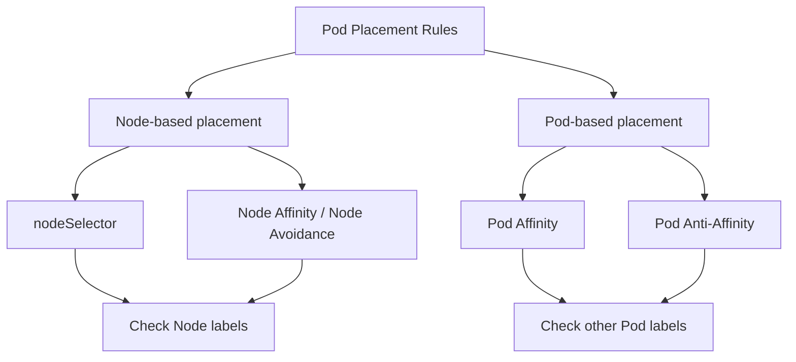
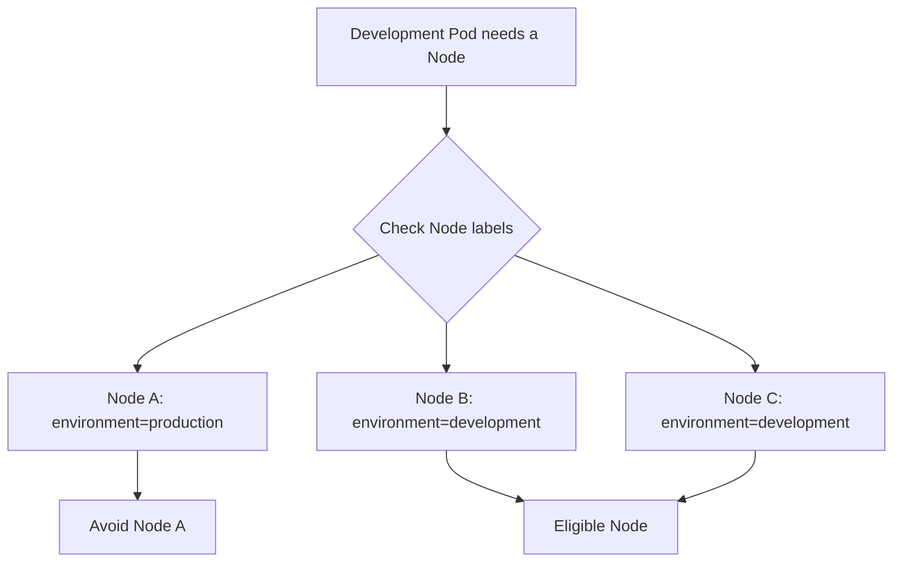
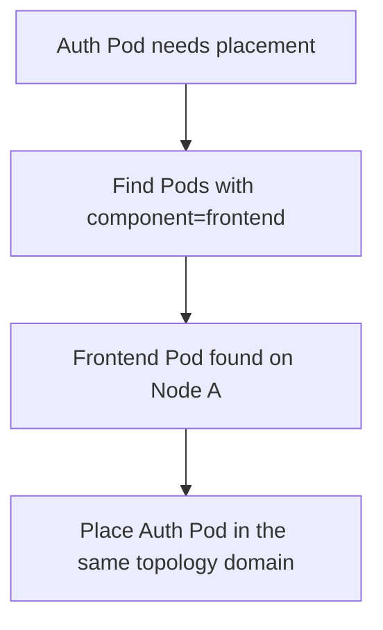
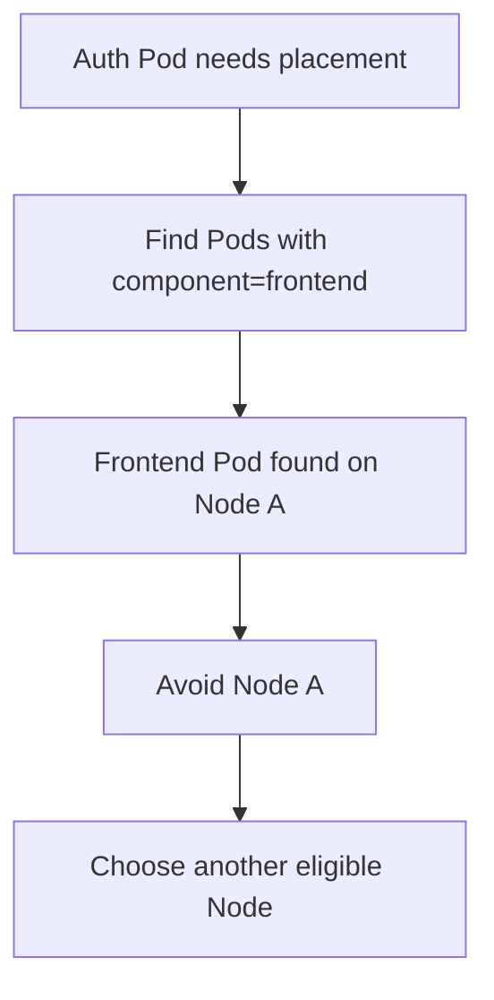
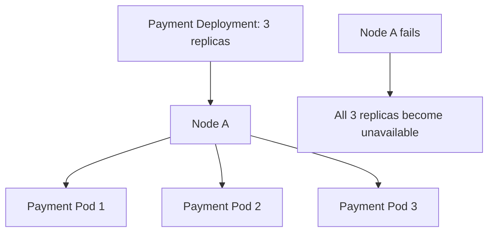
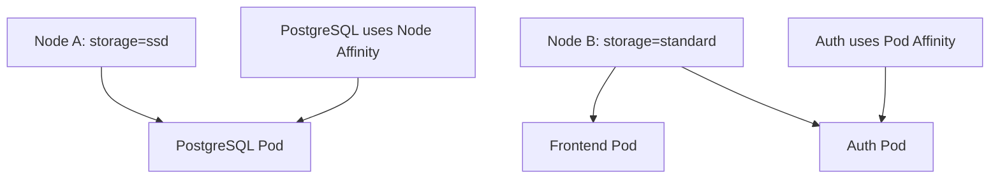
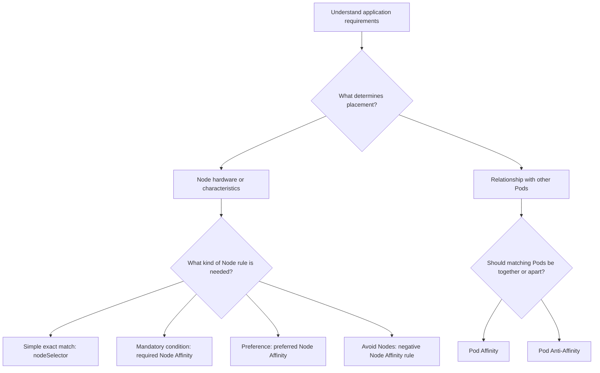
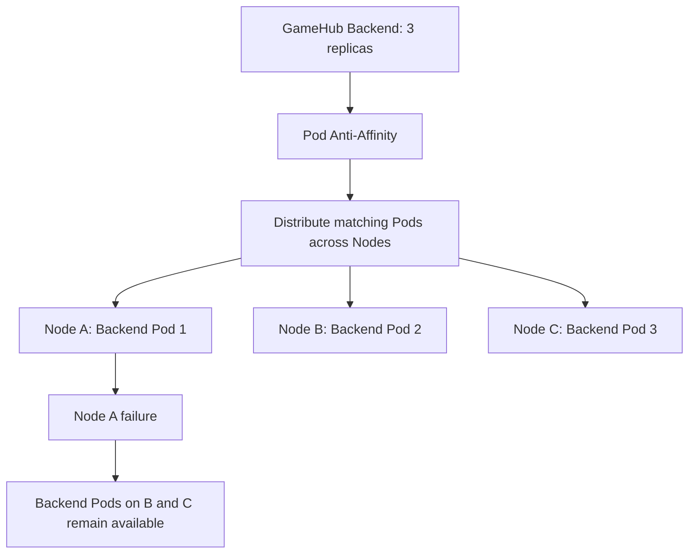

# Kubernetes Pod Placement: Node Selector, Node Affinity, Node Avoidance, Pod Affinity and Pod Anti-Affinity

## 1. First, understand the two categories

Kubernetes has two different placement concepts:

- **Node-based placement:** Controls which Nodes a Pod should or should not be scheduled on.
- **Pod-based placement:** Controls where a Pod should or should not be scheduled in relation to other Pods.

The key difference is **what Kubernetes looks at when making the scheduling decision.**



## 2. Node Selector, Node Affinity and Node Avoidance

### Understand with an example

Imagine your Kubernetes cluster has three Nodes:

| Node | Label |
|---|---|
| Node A | `storage=standard` |
| Node B | `storage=standard` |
| Node C | `storage=ssd` |

Suppose your PostgreSQL database needs SSD storage.

How can we tell Kubernetes to schedule the Database Pod on a suitable Node?

There are two ways: `nodeSelector` and `nodeAffinity`.

### 2.1 What is nodeSelector?

**Meaning:** "Schedule my Pod only on a Node that has this exact label."

Example:

```yaml
spec:
  nodeSelector:
    storage: ssd
```

Kubernetes checks the Node labels and looks for a Node with:

```yaml
storage: ssd
```

In our example:

- Node A: `storage=standard` — does not match.
- Node B: `storage=standard` — does not match.
- Node C: `storage=ssd` — matches.

Therefore, Node C is eligible based on this selector.

**Important:** `nodeSelector` is a strict requirement. If no Node has the specified label, the Pod cannot be scheduled.

### 2.2 What is nodeAffinity?

**Meaning:** "I want my Pod to be scheduled on a Node that satisfies my placement conditions."

Node Affinity provides more flexibility than `nodeSelector`.

We can express conditions using operators such as:

| Operator | Meaning |
|---|---|
| `In` | The label value must be one of the specified values |
| `NotIn` | The label value must not be one of the specified values |
| `Exists` | The label key must exist |
| `DoesNotExist` | The label key must not exist |
| `Gt` | The label value must be greater than the specified value |
| `Lt` | The label value must be less than the specified value |

For example, we can express the same SSD requirement using Node Affinity:

```yaml
spec:
  affinity:
    nodeAffinity:
      requiredDuringSchedulingIgnoredDuringExecution:
        nodeSelectorTerms:
          - matchExpressions:
              - key: storage
                operator: In
                values:
                  - ssd
```

This also selects Node C.

### 2.3 Difference between nodeSelector and nodeAffinity

| Feature | nodeSelector | nodeAffinity |
|---|---|---|
| Purpose | Select Nodes using labels | Select or prefer Nodes using labels |
| Matching | Exact key-value matching | Supports multiple operators |
| Mandatory placement | Yes | Yes, when using `required` |
| Preferred placement | No | Yes, when using `preferred` |
| Flexibility | Simple | More flexible |
| Best suited for | Straightforward label matching | More complex scheduling requirements |

**Remember:**

- `nodeSelector` is simple and strict.
- `nodeAffinity` supports both strict requirements and preferences.

### 2.4 Understanding requiredDuringSchedulingIgnoredDuringExecution

This is a Node Affinity scheduling rule.

**Meaning:** "The Node condition must be satisfied. Otherwise, do not schedule my Pod."

Example:

```yaml
affinity:
  nodeAffinity:
    requiredDuringSchedulingIgnoredDuringExecution:
      nodeSelectorTerms:
        - matchExpressions:
            - key: storage
              operator: In
              values:
                - ssd
```

Kubernetes must find a Node with `storage=ssd`.

If no matching Node is available, the Pod remains `Pending` until a suitable Node becomes available or the scheduling requirements change.

**Business scenario: Database requiring SSD storage**

Imagine an e-commerce company runs a PostgreSQL database that handles thousands of transactions during peak sales.

The company has:

- Standard Nodes with HDD-backed storage.
- Dedicated Nodes with SSD-backed storage.

The database requires SSD-backed infrastructure to meet its storage performance requirements.

The deployment engineer chooses:

`requiredDuringSchedulingIgnoredDuringExecution`

Why?

Because running the database on a Node without the required storage characteristics is not acceptable for this workload.

**Business benefit:**
- Ensures the workload is scheduled only on suitable infrastructure.
- Helps meet performance requirements.
- Avoids scheduling the database on an unsuitable Node.

**What if no SSD Node is available?**

The Pod stays `Pending`. Kubernetes does not silently ignore the requirement and place it on a standard Node.

### 2.5 Understanding preferredDuringSchedulingIgnoredDuringExecution

**Meaning:** "Try to schedule my Pod on a Node that satisfies this condition, but another suitable Node is acceptable if the preferred Node is unavailable."

Example:

```yaml
affinity:
  nodeAffinity:
    preferredDuringSchedulingIgnoredDuringExecution:
      - weight: 80
        preference:
          matchExpressions:
            - key: workload
              operator: In
              values:
                - gpu
```

Here:

- Kubernetes prefers Nodes labelled `workload=gpu`.
- `weight` indicates the preference strength, from 1 to 100.
- The scheduler considers this preference along with other scheduling priorities.
- If a GPU Node is not available, Kubernetes may schedule the Pod on another eligible Node.

**Business scenario: AI analytics application**

Imagine a company runs an analytics application that processes large datasets.

The company has:

- GPU Nodes.
- Standard CPU Nodes.

The application performs better on GPU Nodes, but it can still run on CPU Nodes.

The deployment engineer chooses:

`preferredDuringSchedulingIgnoredDuringExecution`

Why?

Because GPU infrastructure is preferred, but it is not mandatory for the application to function.

**Business benefits:**
- Makes better use of specialized infrastructure when available.
- Allows the application to run even when preferred infrastructure is unavailable.
- Avoids unnecessarily keeping workloads Pending because of a preference.

### 2.6 Required vs Preferred: The important difference

| Question | Required | Preferred |
|---|---|---|
| Is the condition mandatory? | Yes | No |
| What if no matching Node exists? | Pod cannot be scheduled | Scheduler may select another eligible Node |
| Scheduling behaviour | Hard requirement | Soft preference |
| Example | Database must use SSD | Analytics application prefers GPU |

A simple way to remember:

- **Required:** Must have.
- **Preferred:** Nice to have.

### 2.7 What does IgnoredDuringExecution mean?

Both scheduling modes contain:

`IgnoredDuringExecution`

This means Kubernetes checks the Node Affinity condition during scheduling, but does not automatically evict an already-running Pod if the Node's labels later change and no longer satisfy that condition.

For example:

1. A Pod is scheduled on a Node labelled `storage=ssd`.
2. The Pod starts running.
3. Someone removes or changes the Node's `storage=ssd` label.
4. The existing Pod is not automatically evicted just because the label changed.

This is important because scheduling rules and runtime enforcement are not the same thing.

### 2.8 Can we use nodeSelector and nodeAffinity together?

Yes.

If both are specified, the Pod must satisfy both sets of requirements.

For example:

```yaml
spec:
  nodeSelector:
    storage: ssd
  affinity:
    nodeAffinity:
      requiredDuringSchedulingIgnoredDuringExecution:
        nodeSelectorTerms:
          - matchExpressions:
              - key: environment
                operator: In
                values:
                  - production
```

The Node must have both:

- `storage=ssd`
- `environment=production`

This is useful when combining simple label matching with more advanced scheduling conditions.

### 2.9 Node Avoidance (often informally called Node Anti-Affinity)

**Meaning:** "I don't want my Pod to run on a Node with `environment=production`."

Kubernetes can avoid Nodes matching a specified condition using Node Affinity rules with operators such as `NotIn` or `DoesNotExist`.



### Business scenario: Protecting production resources

Imagine a company runs production and development workloads in the same Kubernetes cluster.

Production workloads have dedicated Nodes labelled `environment=production`.

The company wants development workloads to avoid those Nodes.

**Business benefits:**
- Protects resources reserved for production.
- Reduces competition for resources.
- Helps separate workloads based on infrastructure requirements.

**Important Kubernetes detail:**

Kubernetes does not provide a separate `nodeAntiAffinity` field.

Node avoidance is expressed through Node Affinity rules using negative matching operators.

For example:

```yaml
affinity:
  nodeAffinity:
    requiredDuringSchedulingIgnoredDuringExecution:
      nodeSelectorTerms:
        - matchExpressions:
            - key: environment
              operator: NotIn
              values:
                - production
```

This avoids Nodes whose `environment` label has the value `production`.

Remember: `NotIn` can also match Nodes that do not have that label at all. If you need to ensure a label exists, include an appropriate `Exists` requirement.

**Real-world consideration:** For dedicated production Nodes, taints and tolerations are often more appropriate because they can prevent workloads without the required toleration from being scheduled there. Scheduling rules alone do not provide security isolation.

## 3. Pod Affinity and Pod Anti-Affinity

Now imagine your GameHub application has these Pods:

- Frontend Pod
- Auth Pod
- Game Pod
- PostgreSQL Pod

Unlike Node Affinity, these concepts look at labels on other Pods and where those Pods are running.

### Pod Affinity

**Meaning:** "I want my Auth Pod to run in the same topology domain as my Frontend Pod."

For example, the Auth Pod can be scheduled on the same Node as the Frontend Pod.



### Business scenario: Keeping related workloads together

Imagine an online gaming company runs a gaming platform.

Its components include:

- Game API
- Session service
- Game processing service

The Game API frequently communicates with the Session service.

The company wants these workloads in the same Node or availability zone to reduce network latency.

**Scheduling decision:** Pod Affinity.

The Session service can request placement in the same topology domain as Pods labelled `app=game-api`.

**Business benefits:**
- Potentially lower network latency.
- More efficient communication between frequently interacting services.
- Can help optimize application performance.

**Important considerations:**

Keeping Pods together is not always better. It can:

- Increase CPU and memory competition.
- Reduce fault isolation.
- Cause multiple related workloads to be affected by one Node failure.

Pod Affinity does not guarantee faster application performance. Network architecture, resource contention and service traffic also matter.

### Pod Anti-Affinity

**Meaning:** "I don't want my Auth Pod to run in the same topology domain as my Frontend Pod."

Kubernetes avoids placing the Pod in the topology domain containing matching Pods.



### Business scenario: Protecting application availability

Imagine an online banking application has three replicas of its Payment Service.

Thousands of customers use this service. If one Node fails, the company cannot afford to lose all Payment Service replicas.

**Without Pod Anti-Affinity:**

All three replicas might run on the same Node.



If that Node fails, all three replicas could become unavailable.

**With Pod Anti-Affinity:**

Kubernetes can be instructed to spread matching replicas across different Nodes.


**Business benefits:**
- Higher application availability.
- Better fault tolerance.
- Reduced risk of losing all replicas due to one Node failure.
- Better resilience during infrastructure failures.

For stronger resilience, organizations may also spread replicas across availability zones using topology rules.

## 4. What actually makes Node Affinity and Pod Affinity different?

Both concepts ultimately influence where a Pod gets placed.

The difference is not the final Node selected. The difference is **what condition Kubernetes checks before placing the Pod.**

Consider this situation:

- Node A has SSD storage.
- Node B has standard storage.
- Frontend Pod is running on Node B.
- PostgreSQL must run on Node A because it needs SSD.
- Auth must run alongside Frontend.



The reasoning is:

**PostgreSQL Pod — Node Affinity**

- PostgreSQL needs SSD storage.
- Kubernetes checks Node labels.
- It selects Node A because it has `storage=ssd`.

**Auth Pod — Pod Affinity**

- Auth needs to be placed alongside Frontend.
- Kubernetes checks where matching Frontend Pods are running.
- It selects the same topology domain as Frontend, which is Node B in this example.

Notice:

- PostgreSQL chooses Node A because of its infrastructure characteristics.
- Auth chooses Node B because of another Pod's location.

Same cluster, same Nodes, but different scheduling conditions!

### Comparison at a glance

| Question | Node Affinity | Pod Affinity |
|---|---|---|
| What does Kubernetes look at? | Node labels | Labels of other Pods |
| What determines placement? | Node characteristics | Location of matching Pods |
| Example | Find a Node with SSD | Find a Node where Frontend runs |
| Business reason | Suitable infrastructure | Workload proximity |

## 5. Comparison of all placement concepts

| Concept | Looks at | Meaning | Business example |
|---|---|---|---|
| nodeSelector | Node labels | Require an exact label match | Database needs SSD |
| Node Affinity | Node labels | Require or prefer Node characteristics | Database requires SSD; analytics prefers GPU |
| Node Avoidance | Node labels | Avoid particular Nodes | Development workloads avoid production Nodes |
| Pod Affinity | Pod labels | Place near matching Pods | Session service near Game API |
| Pod Anti-Affinity | Pod labels | Place away from matching Pods | Payment replicas on different Nodes |

### What does "near" and "away" mean?

They are determined by a topology rule, such as:

- The same Node.
- The same availability zone.
- Different Nodes.
- Different availability zones.

For example, the `topologyKey` field in Pod Affinity and Pod Anti-Affinity specifies which Node label defines the topology domain.

Pod Affinity does not necessarily mean physically close. It means placement within the topology domain defined by the scheduling rule.

## 6. How deployment engineers decide

An engineer doesn't randomly choose placement rules. They first understand the application's business requirements.

| Business requirement | Possible scheduling decision |
|---|---|
| Database needs an exact Node label match | nodeSelector |
| Database must use SSD hardware | Required Node Affinity |
| Analytics workload prefers GPU but can use CPU | Preferred Node Affinity |
| Development workloads should avoid designated production Nodes | Node avoidance using Node Affinity |
| Related workloads benefit from being close | Pod Affinity |
| Backend replicas should survive a Node failure | Pod Anti-Affinity |

### Real-world decision-making flow



### Important considerations before applying placement rules

Affinity rules can make scheduling more restrictive.

For example:

- If no Node matches the required Node Affinity rule, the Pod may remain Pending.
- If Pod Anti-Affinity cannot find an eligible topology domain, the Pod may remain Pending.
- A cluster with only one Node cannot distribute replicas across multiple Nodes.
- A preferred Node Affinity rule is not a guarantee that the Pod will run on the preferred Node.

Engineers must balance placement requirements against available cluster capacity.

## 7. Connect the concepts to GameHub

Imagine your GameHub backend has three replicas.

Your business requirement is:

"If one Kubernetes Node goes down, the remaining backend replicas should still be available."

**Scheduling decision: Pod Anti-Affinity**

Why?

Because the requirement is about distributing related Pods across different Nodes, not selecting Nodes based on their hardware labels.



This is the kind of reasoning a deployment engineer should develop before writing YAML.

**One limitation in our current Minikube setup:** Your GameHub cluster currently has only one Node. We can understand and test the scheduling rules, but we cannot demonstrate actual multi-Node distribution or Node-level fault tolerance until we have multiple Nodes.

## 8. Key Takeaways

The easiest way to remember the concepts:

- **nodeSelector:** Select a Node using exact key-value label matching.
- **Node Affinity:** Require or prefer Nodes based on their labels.
- **Node Avoidance:** Avoid Nodes based on their labels, using Node Affinity rules.
- **Pod Affinity:** Place a Pod near matching Pods.
- **Pod Anti-Affinity:** Place a Pod away from matching Pods.

Remember these two Node Affinity modes:

- **Required:** The condition must be satisfied for scheduling.
- **Preferred:** Kubernetes tries to satisfy the condition, but can choose another eligible Node.

The most important distinction:

**Node-based placement works with Node labels, whereas Pod-based placement works with Pod labels.**

Always start with the business requirement, then decide which scheduling rule can help meet it.

### Before writing YAML, ask yourself:

1. Does this workload need a particular type of infrastructure?
2. Is an exact Node label match enough, or do I need advanced conditions?
3. Is the Node condition mandatory or just preferred?
4. Should this workload avoid particular Nodes?
5. Should this workload be placed close to another workload?
6. Should this workload be separated from another workload for availability?

These questions help a deployment engineer choose the right scheduling strategy before implementing it.