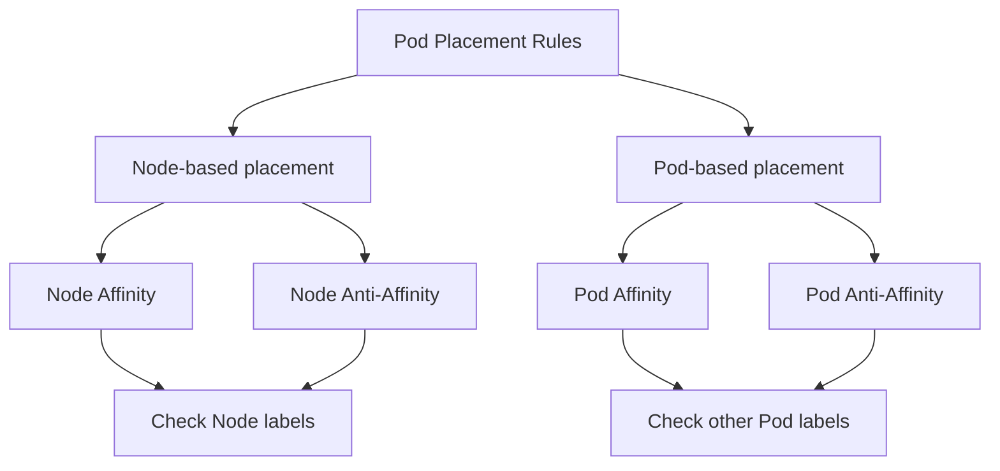
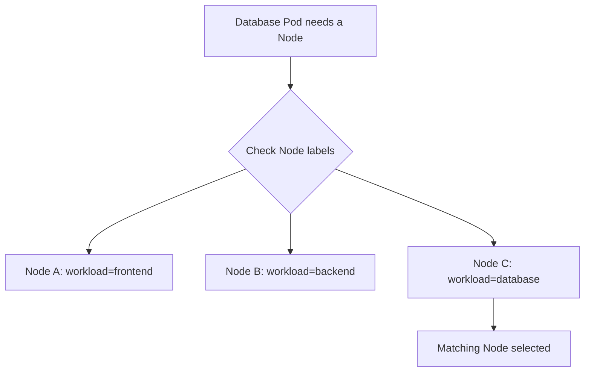
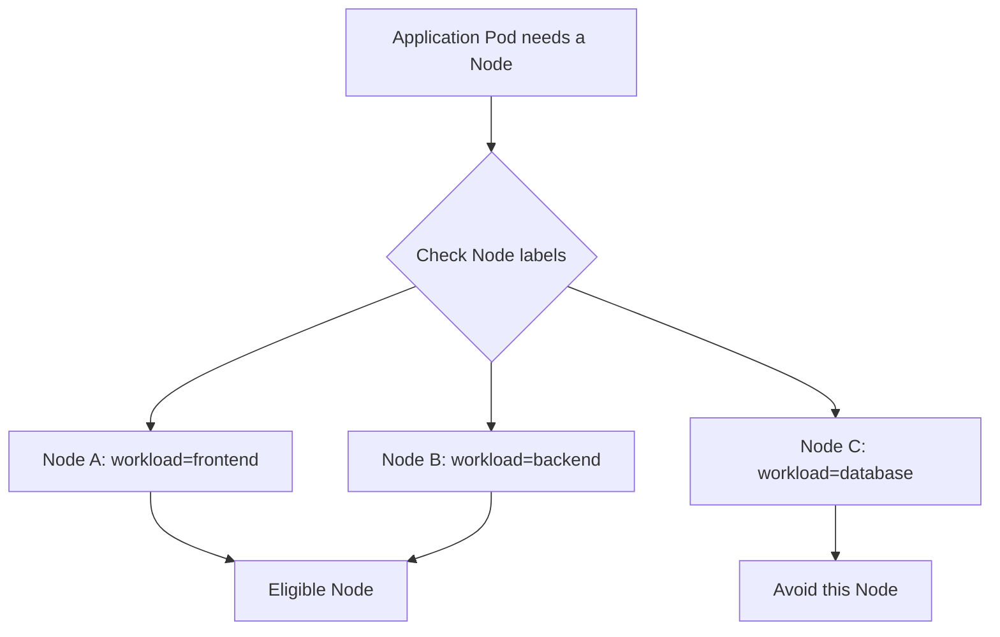
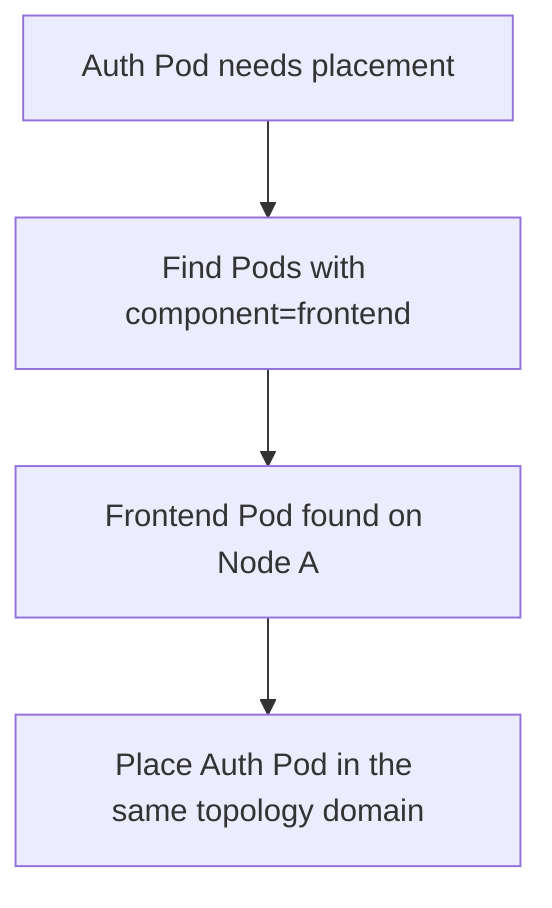
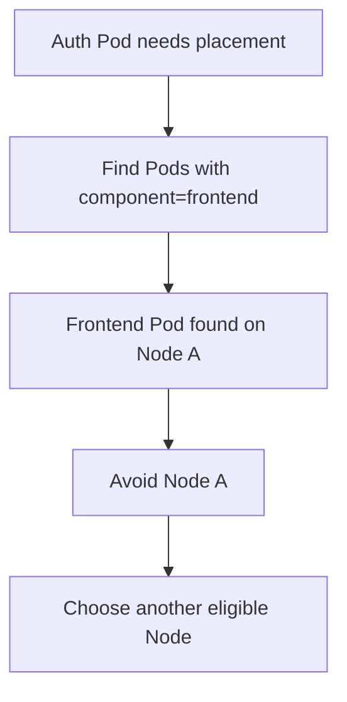
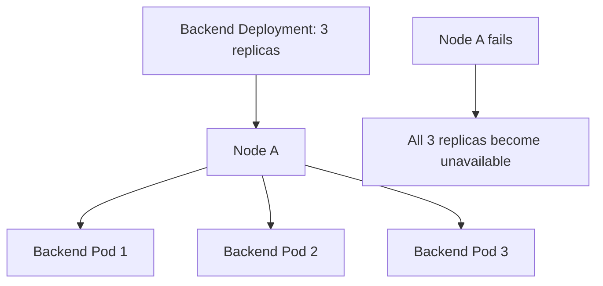
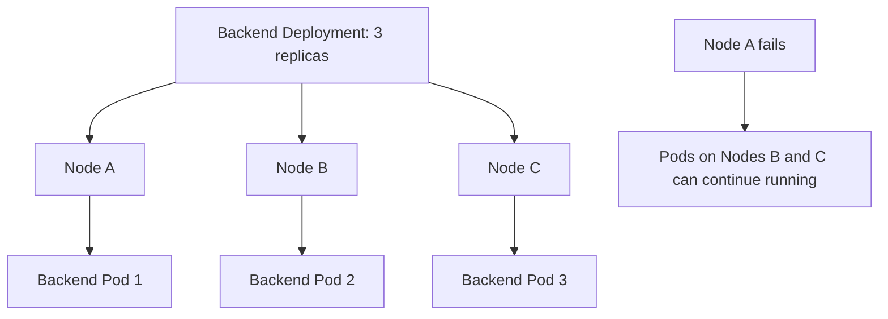
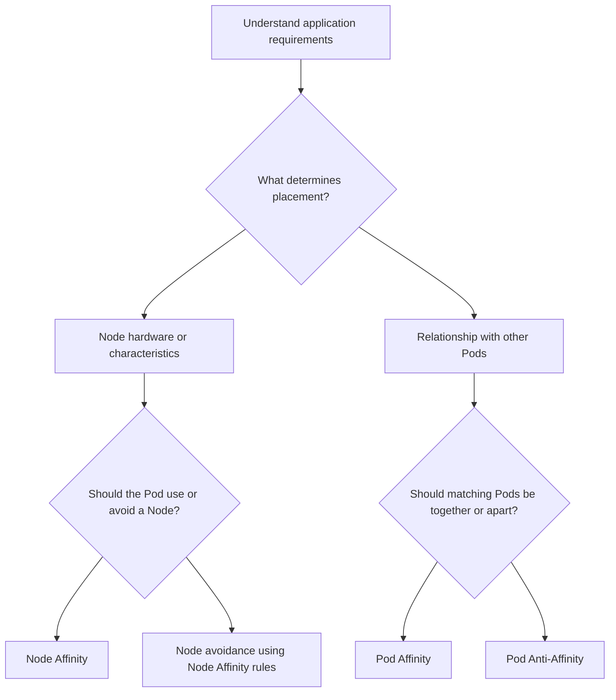
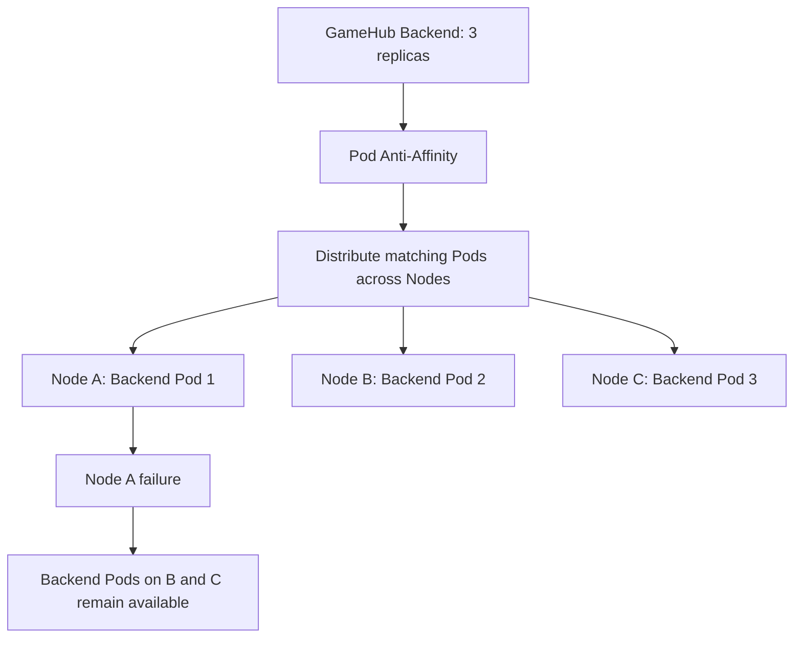

# Kubernetes Pod Placement: Node Affinity, Node Anti-Affinity, Pod Affinity and Pod Anti-Affinity

## 1. First, understand the two categories

Kubernetes has two different placement concepts:

- **Node Affinity / Node Anti-Affinity:** Controls which Nodes a Pod should or should not be scheduled on.
- **Pod Affinity / Pod Anti-Affinity:** Controls where a Pod should or should not be scheduled in relation to other Pods.

The key difference is **what Kubernetes looks at when making the scheduling decision.**

## 2. Node Affinity vs Node Anti-Affinity

### Understand with an example

Imagine your Kubernetes cluster has three Nodes:

| Node | Label |
|---|---|
| Node A | `workload=frontend` |
| Node B | `workload=backend` |
| Node C | `workload=database` |

### Node Affinity

**Meaning:** "I want my Pod to run on a Node with `workload=database`."

Kubernetes checks the labels on Nodes and schedules the Pod on a matching Node.

**Business scenario: Choosing suitable infrastructure**

Imagine an e-commerce application has:

- Frontend application
- Backend application
- Database

The database needs SSD storage for better disk performance.

| Node | Label |
|---|---|
| Node A | `storage=standard` |
| Node B | `storage=ssd` |
| Node C | `storage=standard` |

The database Pod uses Node Affinity to select a Node with `storage=ssd`.

**Business benefits:**
- Better database performance.
- Workloads get the infrastructure they require.
- Avoids placing demanding workloads on unsuitable Nodes.

Other real-world examples:
- GPU-intensive AI workloads on GPU Nodes.
- Memory-intensive applications on high-memory Nodes.
- Production workloads on designated production Nodes.

### Node Anti-Affinity

**Meaning:** "I don't want my Pod to run on a Node with `workload=database`."

Kubernetes avoids Nodes that match the specified condition.

**Business scenario: Avoiding unsuitable infrastructure**

Imagine an organization has dedicated Nodes for critical production workloads. It wants to prevent certain non-production workloads from using those Nodes.

**Business benefits:**
- Better resource management.
- Reduced competition for resources.
- Separation of workloads based on infrastructure requirements.

**Important Kubernetes detail:** Kubernetes does not provide a separate `nodeAntiAffinity` field. Node avoidance is expressed through Node Affinity rules using operators such as `NotIn` or `DoesNotExist`.

For strict workload isolation, organizations may also use taints and tolerations, along with appropriate security controls. Node avoidance alone is not a security boundary.

---

## 3. Pod Affinity vs Pod Anti-Affinity

Now imagine your GameHub application has these Pods:

- Frontend Pod
- Auth Pod
- Game Pod
- PostgreSQL Pod

Unlike Node Affinity, these concepts look at labels on other Pods and where those Pods are running.

### Pod Affinity

**Meaning:** "I want my Auth Pod to run in the same topology domain as my Frontend Pod."

For example, the Auth Pod can be scheduled on the same Node as the Frontend Pod.

**Business scenario: Keeping related workloads together**

Imagine two application components communicate frequently:

- Auth Service
- Game Service

An organization may choose to place related workloads in the same topology domain to reduce network latency.

**Business benefits:**
- Potentially lower network latency.
- Better communication efficiency for workloads with frequent interactions.
- Can help optimize application performance.

**Important:** Keeping Pods together is not always better. It can increase CPU and memory competition and reduce fault isolation.

### Pod Anti-Affinity

**Meaning:** "I don't want my Auth Pod to run in the same topology domain as my Frontend Pod."

Kubernetes avoids placing the Pod in the topology domain containing matching Pods.

**Business scenario: Improving application availability**

This is one of the most important real-world use cases!

Imagine an application has three replicas of its backend.

Without Pod Anti-Affinity, all three replicas might run on the same Node.

If that Node fails, all three replicas could become unavailable.

With Pod Anti-Affinity, Kubernetes can be instructed to spread matching replicas across different Nodes.

**Business benefits:**
- Better availability.
- Reduced risk of losing all replicas due to one Node failure.
- Improved fault tolerance.
- Helps maintain application availability during infrastructure failures.

For stronger resilience, organizations may also spread replicas across availability zones using topology rules.

---

## 4. Comparison at a glance

| Concept | Looks at | Meaning |
|---|---|---|
| Node Affinity | Node labels | Prefer or require a particular Node |
| Node Anti-Affinity | Node labels | Avoid particular Nodes |
| Pod Affinity | Pod labels | Place near matching Pods |
| Pod Anti-Affinity | Pod labels | Place away from matching Pods |

### What does "near" and "away" mean?

They are determined by a topology rule, such as:

- The same Node.
- The same availability zone.
- Different Nodes.
- Different availability zones.

For example, the `topologyKey` field in Pod Affinity and Pod Anti-Affinity specifies which Node label defines the topology domain.

Pod Affinity does not necessarily mean physically close. It means placement within the topology domain defined by the scheduling rule.

---

## 5. How deployment engineers decide

An engineer doesn't randomly choose affinity rules. They first understand the application's requirements.

| Business requirement | Possible scheduling decision |
|---|---|
| Database needs SSD hardware | Node Affinity |
| Development workloads should avoid designated production Nodes | Node avoidance rules |
| Related workloads benefit from being close | Pod Affinity |
| Backend replicas should survive a Node failure | Pod Anti-Affinity |

### Real-world decision-making flow

### Important considerations before applying affinity rules

Affinity rules can make scheduling more restrictive.

For example:
- If no Node matches the required Node Affinity rule, the Pod may remain Pending.
- If Pod Anti-Affinity cannot find an eligible topology domain, the Pod may remain Pending.
- A cluster with only one Node cannot distribute replicas across multiple Nodes.

Engineers must balance placement requirements against available cluster capacity.

---

## 6. Connect the concepts to GameHub

Imagine your GameHub backend has three replicas.

Your business requirement is:

"If one Kubernetes Node goes down, the remaining backend replicas should still be available."

**Scheduling decision: Pod Anti-Affinity**

Why?

Because the requirement is about distributing related Pods across different Nodes, not selecting Nodes based on their hardware labels.

This is the kind of reasoning a deployment engineer should develop before writing YAML.

**One limitation in our current Minikube setup:** Your GameHub cluster currently has only one Node. We can understand and test the scheduling rules, but we cannot demonstrate actual multi-Node distribution or Node-level fault tolerance until we have multiple Nodes.

---

## 7. Key Takeaways

The easiest way to remember all four concepts:

- **Node Affinity:** Choose a Node based on its labels.
- **Node Anti-Affinity:** Avoid a Node based on its labels.
- **Pod Affinity:** Place a Pod near matching Pods.
- **Pod Anti-Affinity:** Place a Pod away from matching Pods.

The most important distinction:

**Node Affinity works with Node labels, whereas Pod Affinity works with Pod labels.**

Always start with the business requirement, then decide which scheduling rule can help meet it.