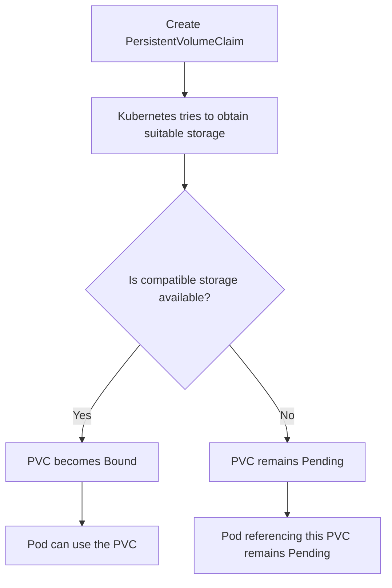
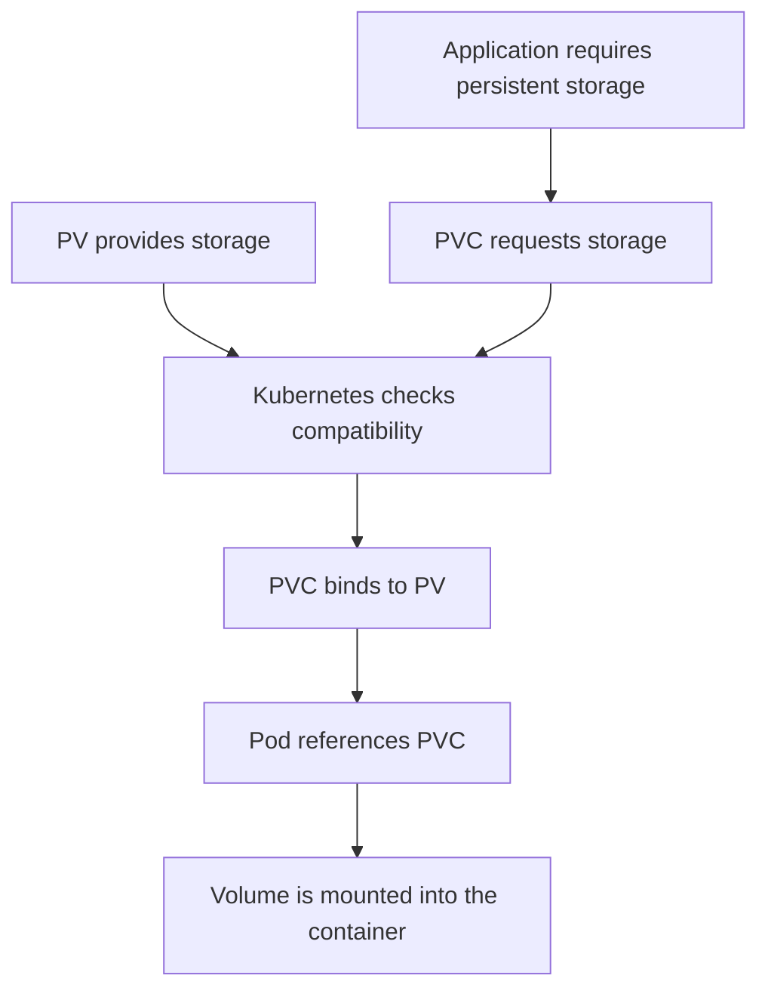
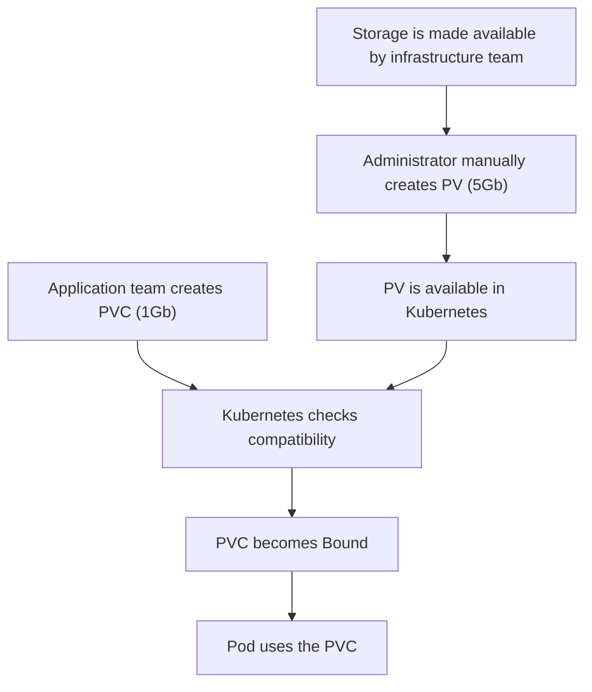
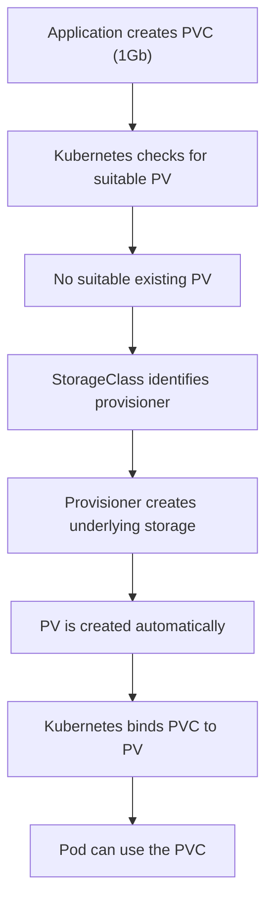
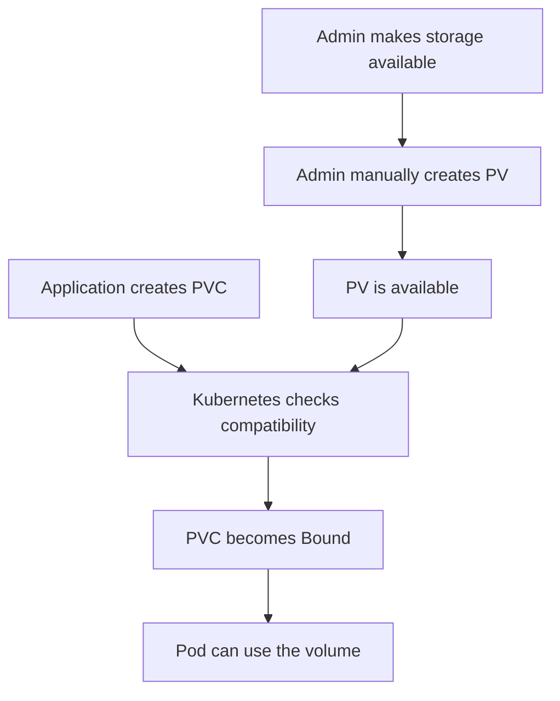
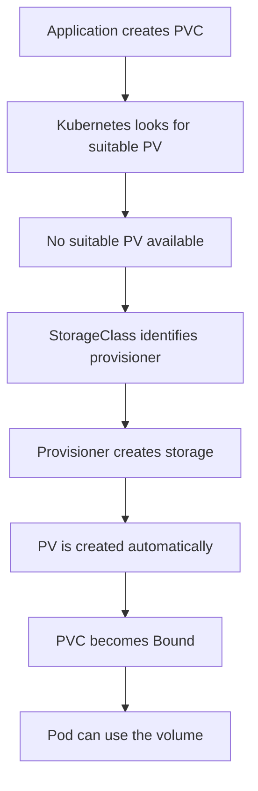
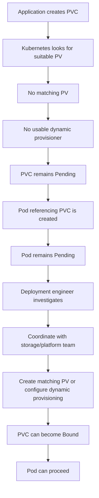
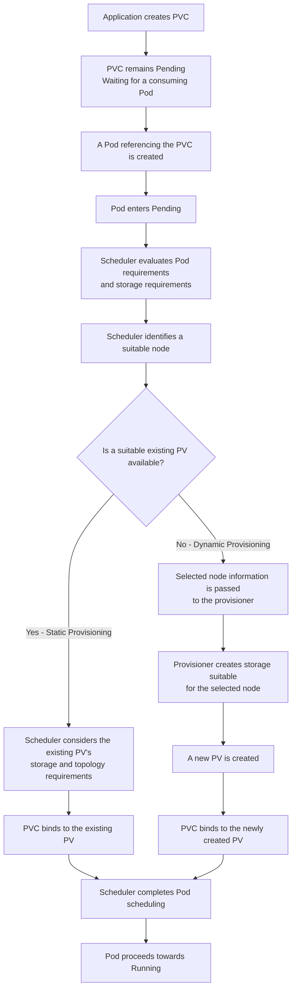
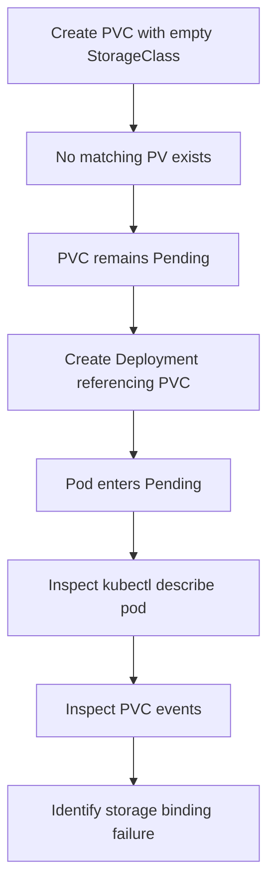

# Kubernetes Troubleshooting – Unbound PersistentVolumeClaim (PVC)

## 1. Objective

Understand and reproduce the Kubernetes issue **Unbound PersistentVolumeClaim (PVC)**, where a Pod remains in the `Pending` state because the storage requested by its PVC has not been made available.

The objective is to understand:

- How PersistentVolumes (PVs) and PersistentVolumeClaims (PVCs) work together.
- Why a PVC can remain in the `Pending` state.
- How an unbound PVC affects a Deployment and its Pods.
- The difference between static and dynamic provisioning.
- The purpose of a StorageClass and a provisioner.
- How default StorageClass assignment works.
- The different scenarios in which storage can be provisioned or remain unavailable.
- The responsibilities of application developers, deployment engineers and Kubernetes administrators.
- How to investigate and resolve storage-related deployment failures.

We will reproduce this issue using the existing GameHub Kubernetes learning environment without affecting the running GameHub application or its PostgreSQL database.

---

## 2. Understanding the problem

### What is the issue?

A Deployment may require persistent storage for its container.

Instead of directly allocating storage, Kubernetes applications generally request storage through a PersistentVolumeClaim (PVC).

A PVC represents a request for storage.

Kubernetes tries to find an available PersistentVolume (PV) that satisfies the requirements of that claim.

If suitable storage is unavailable, the PVC remains in the `Pending` state.

When a Pod depends on that PVC, the Pod cannot proceed with its normal scheduling and startup process.

### Expected flow



**Important:** A Deployment can be created successfully even when its Pod cannot start because its storage requirement is not satisfied.

The Deployment object and the Pod are different Kubernetes resources. Creating a Deployment does not guarantee that its Pods will become operational.

---

## 3. Understanding PersistentVolume and PersistentVolumeClaim

### 3.1 PersistentVolume (PV)

A PersistentVolume is a storage resource made available to the Kubernetes cluster.

It represents storage provided by an underlying storage system.

Examples:

- AWS EBS volume.
- Azure Disk.
- Google Persistent Disk.
- Local storage.
- NFS storage.

A PV has properties such as:

- Storage capacity.
- Access modes.
- StorageClass.
- Reclaim policy.
- Volume details.

A PV can be created manually by an administrator or automatically through dynamic provisioning.

### 3.2 PersistentVolumeClaim (PVC)

A PersistentVolumeClaim is a request for storage made by an application.

It specifies requirements such as:

- Required storage capacity.
- Access modes.
- StorageClass, if required.

The application does not normally reference a PV directly.

Instead, the application references a PVC, and Kubernetes connects that claim to a suitable PV.

### 3.3 Relationship between PV and PVC

Think of:

- PV = Storage made available to the cluster.
- PVC = Application's request for storage.
- Kubernetes = Matches the request with suitable available storage.



### Important: One PV and one PVC

One PV can be bound to only one PVC at a time.

Kubernetes does not divide a PV into smaller PVs automatically to satisfy multiple claims.

For example:

- PV-1 has a capacity of 5Gb.
- PVC-1 requests 1Gb.
- PVC-1 binds to PV-1.
- Another PVC cannot claim the unused 4Gb from that same PV.

The entire PV is associated with that one claim.

**Deployment engineer's perspective:** When planning storage, consider not only the capacity requested by the application but also how storage resources will be allocated and used across applications.

---

### 3.4 Understanding Physical Disks, Logical Volumes and Kubernetes PVs

One important distinction to understand is that **physical disks, logical volumes and Kubernetes PersistentVolumes are not the same thing.**

Let's understand this with an example.

#### Step 1: A storage backend has multiple physical disks

Imagine a production storage system has five physical disks.

Each disk has 100GB of capacity.

The storage backend has a total of 500GB across these disks.

```text
Physical disks

Disk 1: 100GB
Disk 2: 100GB
Disk 3: 100GB
Disk 4: 100GB
Disk 5: 100GB

Total: 500GB
```

At this point, these are physical storage devices managed by the storage infrastructure.

Kubernetes does not necessarily see each physical disk individually.

#### Step 2: The storage backend combines them into a storage pool

The storage backend can combine the capacity of these disks into one storage pool.

```text
       Storage backend
              |
    ---------------------
    |   |   |   |   |
   D1  D2  D3  D4  D5
    \   \   |   /   /
     \   \  |  /   /
      Storage pool
          500GB
```

**Important:** The storage backend performs this aggregation. Kubernetes is not combining PVs here.

The storage backend decides how to manage the physical disks and allocate storage from the pool.

#### Step 3: The backend creates one logical volume

Suppose the backend creates one logical volume of 500GB from this storage pool.

A logical volume is a storage resource presented by the backend. It does not necessarily correspond to one physical disk.

```text
Five physical disks
        |
        v
Storage backend combines their capacity
        |
        v
One storage pool (500GB)
        |
        v
One logical volume (500GB)
```

#### Step 4: Kubernetes sees the logical volume as one PV

The storage system makes this logical volume available to Kubernetes through the appropriate storage integration, such as a CSI driver.

CSI (Container Storage Interface) Driver : software component that lets storage systems connect to container orchestrators like Kubernetes.

Kubernetes sees the resulting storage resource as one PersistentVolume.

```text
Storage backend
      |
      v
One logical volume (500GB)
      |
      v
Kubernetes
      |
      v
One PV (500GB)
      |
      v
PVC requests 500GB
      |
      v
PVC binds to that one PV
```

The important point is that Kubernetes sees **one PV of 500GB**, not five PVs of 100GB each.

The PVC requesting 500GB can bind to that one PV, provided the other requirements are also satisfied.

---

#### What if Kubernetes sees five separate PVs instead?

Now consider a different situation.

The storage infrastructure presents five separate storage resources to Kubernetes.

Kubernetes sees:

```text
PV-1: 100GB
PV-2: 100GB
PV-3: 100GB
PV-4: 100GB
PV-5: 100GB
```

An application creates one PVC requesting 500GB.

Can Kubernetes combine these five PVs to satisfy that one PVC?

**No.**

Kubernetes PV/PVC binding is one-to-one.

One PVC binds to one suitable PV. Kubernetes does not combine multiple PV objects to satisfy a single PVC.

```text
PV-1 (100GB) ----\
PV-2 (100GB) -----\
PV-3 (100GB) ------X---- PVC (500GB)
PV-4 (100GB) -----/
PV-5 (100GB) ----/

Cannot combine these PVs to satisfy the PVC.
```

If no single suitable PV exists and no working dynamic provisioner can create a suitable volume, the PVC remains `Pending`.

---

#### The most important distinction

| Storage situation | Who performs the operation? | What Kubernetes sees |
|---|---|---|
| Combining physical disks into a storage pool | Storage backend | Not necessarily the individual physical disks |
| Creating a logical volume from the storage pool | Storage backend | A storage resource that can be represented by a PV |
| Creating a PV for that logical volume | Administrator or dynamic provisioning integration | One PV |
| Binding a PVC to a PV | Kubernetes | One PVC associated with one PV |
| Combining multiple PV objects to satisfy one PVC | Not supported by normal PV/PVC binding | Kubernetes does not do this |

**Deployment engineer's perspective:**

When working with production Kubernetes environments, do not assume that one physical disk equals one PV.

The storage infrastructure may use RAID, storage pools, distributed storage or other backend mechanisms to provide logical volumes.

Your responsibility as a deployment engineer is to understand what storage the Kubernetes cluster is actually being offered.

When troubleshooting, inspect the PV objects using:

```powershell
kubectl get pv
kubectl describe pv <pv-name>
```

Look at the capacity, access modes, StorageClass and volume details.

Remember:

- The storage backend manages physical storage.
- The backend can create logical volumes using its own storage architecture.
- Kubernetes represents the storage made available to it through PVs.
- Kubernetes binds a PVC to one suitable PV.
- Kubernetes does not combine multiple PV objects to satisfy one PVC.

---

## 4. Access Modes and Compatibility

A PVC specifies how it wants to access the storage.

The available access modes include:

| Access mode | Meaning |
|---|---|
| ReadWriteOnce (RWO) | Volume can be mounted read-write by a single node |
| ReadOnlyMany (ROX) | Volume can be mounted read-only by multiple nodes |
| ReadWriteMany (RWX) | Volume can be mounted read-write by multiple nodes |
| ReadWriteOncePod (RWOP) | Volume can be mounted read-write by a single Pod |

**Important distinction:** ReadWriteOnce means one node, not necessarily one Pod. Multiple Pods on the same node can potentially use an RWO volume, subject to the volume driver and other constraints.

### What happens when access modes are incompatible?

Example:

- PVC requests `ReadWriteOnce`.
- Available PV supports only `ReadOnlyMany`.

The PV cannot satisfy the PVC's requested access mode.

Therefore, the PVC cannot bind to that PV.

If a Pod requires that PVC, the Pod can remain `Pending`.

**Deployment engineer's perspective:** Do not select an access mode just because it is available. Understand how the application accesses its data and how many nodes or Pods need to use the volume.

---

## 5. Understanding StorageClass

### 5.1 What is a StorageClass?

A StorageClass is a Kubernetes resource that describes a category or class of storage available in the cluster.

It provides configuration that determines how storage should be provisioned when dynamic provisioning is used. It identifies the provisioner responsible for creating storage and can include additional parameters that define the characteristics of the storage.

A StorageClass can also be assigned to a manually created PV. In that case, it acts as a matching criterion when Kubernetes binds a PVC to the PV. It does not trigger dynamic provisioning by itself.

**Important points:**

- A StorageClass does not represent actual storage.
- It does not contain the storage capacity requested by an application.
- In dynamic provisioning, it provides configuration for the provisioner.
- In static provisioning, its name can be used to match a PVC with an existing PV.

Think of it as a storage classification and provisioning configuration, rather than storage itself.

### 5.2 StorageClass compatibility

Example:

| Resource | StorageClass |
|---|---|
| PV-1 | fast-storage |
| PV-2 | standard |
| PVC | fast-storage |

The PVC can potentially bind to PV-1 because their StorageClasses match, provided all other requirements are satisfied.

It cannot bind to PV-2 because its StorageClass is different.

StorageClass compatibility is one of the conditions Kubernetes checks while binding a PVC to a PV.

### 5.3 What is a provisioner?

A provisioner is the component responsible for creating storage when dynamic provisioning is requested.

The StorageClass provides the configuration that tells Kubernetes which provisioner to use.

The provisioner performs the storage provisioning operation through the underlying storage system.

Examples:

- AWS EBS CSI driver.
- Azure Disk CSI driver.
- Google Compute Engine Persistent Disk CSI driver.
- Minikube hostpath provisioner.

**Important distinction:**

- StorageClass describes the storage class and provisioning configuration.
- Provisioner performs the dynamic storage creation.
- PV represents the resulting storage resource.
- PVC requests storage.


### 5.3.1 How to Identify Whether a StorageClass Supports Dynamic Provisioning?

We now understand what a provisioner does.

But as Kubernetes administrators or deployment engineers, how do we identify whether a StorageClass is configured for dynamic provisioning or static provisioning?

The important field to inspect is:

`provisioner`

#### Step 1: List the available StorageClasses

Command:

```powershell
kubectl get storageclass
```

Example output from our Minikube cluster:

```text
NAME                 PROVISIONER                RECLAIMPOLICY   VOLUMEBINDINGMODE
standard (default)   k8s.io/minikube-hostpath   Delete          Immediate
```

Here:

- `standard` is the StorageClass name.
- `k8s.io/minikube-hostpath` is the configured provisioner.
- This provisioner supports dynamic provisioning.

#### Step 2: Inspect a particular StorageClass

Command:

```powershell
kubectl describe storageclass standard
```

Alternatively:

```powershell
kubectl get storageclass standard -o yaml
```

Inspect the `provisioner` field to understand which provisioner is configured.

#### Understanding Different Provisioner Values

| Provisioner value | Meaning |
|---|---|
| `k8s.io/minikube-hostpath` | Minikube hostPath provisioner; supports dynamic provisioning |
| `ebs.csi.aws.com` | AWS EBS CSI provisioner |
| `disk.csi.azure.com` | Azure Disk CSI provisioner |
| `kubernetes.io/no-provisioner` | No dynamic provisioning through this StorageClass |

**Important:** A provisioner name in the StorageClass does not guarantee that the corresponding provisioner is installed and working. We must also verify the provisioner's availability and health.

---

#### 5.3.2 What Does `kubernetes.io/no-provisioner` Mean?

Consider this example:

```yaml
apiVersion: storage.k8s.io/v1
kind: StorageClass
metadata:
  name: manual
provisioner: kubernetes.io/no-provisioner
```

Here, we have two different fields to understand.

| Field | Value | Explanation |
|---|---|---|
| `metadata.name` | `manual` | Name of the StorageClass, chosen by the administrator |
| `provisioner` | `kubernetes.io/no-provisioner` | Special Kubernetes-recognized value indicating that no dynamic provisioner is used |

**Is `manual` a built-in Kubernetes StorageClass name?**

No.

`manual` is simply an administrator-chosen name. We could use:

- `manual`
- `static-storage`
- `my-storage`

The name does not determine whether provisioning is static or dynamic.

**Is `kubernetes.io/no-provisioner` a real provisioner name?**

It is a special, Kubernetes-recognized provisioner identifier used to indicate that dynamic provisioning is not performed through that StorageClass.

It is not an arbitrary placeholder that we replace with another name.

For example:

```yaml
metadata:
  name: static-storage
provisioner: kubernetes.io/no-provisioner
```

This has the same provisioning behaviour as the previous example. Only the StorageClass name has changed.

#### What if we specify a different provisioner name?

Consider:

```yaml
metadata:
  name: my-storage
provisioner: my-custom-provisioner
```

Kubernetes sees `my-custom-provisioner` as the provisioner identifier.

However, simply writing this name does not install or create a provisioner.

A corresponding provisioner implementation must exist and be operational to handle dynamic provisioning requests.

---

#### 5.3.3 Sample StorageClass Outputs: Dynamic vs Static

The following are illustrative examples. They are not necessarily both present in our Minikube cluster.

**Example A: StorageClass configured for dynamic provisioning**

```text
NAME      PROVISIONER
standard  k8s.io/minikube-hostpath
```

The provisioner can create storage automatically when a suitable PVC requests it.

**Example B: StorageClass configured for static provisioning**

```text
NAME      PROVISIONER
manual    kubernetes.io/no-provisioner
```

No dynamic provisioning takes place through this StorageClass.

The administrator must:

1. Make the underlying storage available.
2. Manually create a PV representing that storage.
3. Make the PV available for PVC binding.
4. Allow Kubernetes to match and bind a suitable PVC to that PV.

**Important:** `kubernetes.io/no-provisioner` does not create a PV. The administrator is responsible for making storage available and creating the PV.

---

#### 5.3.4 Can Static and Dynamic Provisioning Coexist in the Same Cluster?

Yes!

A Kubernetes cluster can support both static and dynamic provisioning at the same time.

**Configuring one provisioning approach does not disable the other.**

Let's understand this from both directions.

**Scenario 1: A cluster starts with dynamic provisioning**

Suppose:

- The cluster has a working `standard` StorageClass.
- Its provisioner is `k8s.io/minikube-hostpath`.
- Dynamic provisioning is already working.

Now, an application requires storage that will be managed manually.

1. The Kubernetes administrator makes the underlying storage available.
2. The administrator manually creates a PV.
3. The PV is configured with a suitable StorageClass, for example, `manual`.
4. The application team creates a PVC requesting the same StorageClass.
5. Kubernetes checks compatibility and binds the PVC to the manually created PV.

The existing dynamic provisioner continues serving other PVCs.

**We do not need to remove or disable the existing dynamic provisioner to use static provisioning.**

**Scenario 2: A cluster starts with static provisioning**

Now consider the reverse situation.

Suppose:

- The administrator initially makes storage available manually.
- The administrator creates PVs.
- Applications create PVCs that bind to those existing PVs.

Later, the platform team configures a dynamic provisioner and creates a StorageClass that uses it.

1. The platform team installs and configures the dynamic provisioner.
2. A StorageClass is created that references the provisioner.
3. Another application creates a PVC requesting that StorageClass.
4. If no suitable existing PV is available, the configured provisioner can create the underlying storage.
5. A PV is created automatically.
6. Kubernetes binds the PVC to the newly created PV.

The previously created static PVs remain available for suitable claims.

**Configuring dynamic provisioning does not stop the cluster from using manually created PVs.**

**Comparison**

| Situation | What happens? |
|---|---|
| Only static provisioning is configured | Administrators manually create PVs |
| Only dynamic provisioning is configured | A working provisioner creates storage for eligible PVCs |
| Both are available | Applications can use suitable existing PVs or request dynamically provisioned storage |

**Important distinction:**

Kubernetes does not automatically switch to static provisioning when dynamic provisioning fails.

For static binding to happen, a suitable manually created PV must already be available. Similarly, configuring a dynamic provisioner does not automatically convert existing static PVs into dynamically provisioned storage.

#### Deployment Engineer's Perspective

As deployment engineers, we should not think of static and dynamic provisioning as mutually exclusive cluster modes.

Instead, understand:

- Which StorageClasses are available?
- Which provisioner is configured for each StorageClass?
- Is the provisioner installed and healthy?
- Are suitable manually created PVs available?
- What storage requirements does the application have?
- Which provisioning approach has been agreed upon by the application and platform teams?

**Key takeaway:**

Static and dynamic provisioning can coexist in the same Kubernetes cluster. Adding dynamic provisioning does not disable static provisioning, and using static provisioning does not require disabling an existing dynamic provisioner.

The actual provisioning path depends on the PVC, the available PVs, the StorageClass configuration and the working provisioner.

### 5.4 Static provisioning can also use a StorageClass

A common misunderstanding is that a StorageClass always means dynamic provisioning.

That is not correct.

A manually created PV can also have a StorageClass name.

For example:

- Administrator manually creates PV-1 with StorageClass `fast-storage`.
- Application creates a PVC requesting `fast-storage`.
- Kubernetes checks the other requirements.
- Kubernetes can bind the PVC to PV-1.

Therefore:

- Static provisioning can use a StorageClass.
- Dynamic provisioning uses a StorageClass in the standard StorageClass-based workflow.
- Merely assigning a StorageClass name does not mean storage is dynamically created.

---

## 6. Understanding storageClassName: omitted vs empty vs specified

There are three important configurations to understand.

### 1. StorageClass explicitly specified

```yaml
spec:
  storageClassName: standard
```

The PVC requests the specified StorageClass.

Kubernetes can:

- Bind the PVC to a suitable existing PV with the same StorageClass.
- Use the StorageClass's provisioner to dynamically create storage if no suitable existing PV is available.

### 2. Empty StorageClass

```yaml
spec:
  storageClassName: ""
```

The PVC explicitly requests storage without a StorageClass.

This means:

- It does not use the default StorageClass.
- It requires a suitable PV without a StorageClass.
- If no matching PV exists, the PVC remains `Pending`.

This is useful when we intentionally want to prevent default StorageClass-based dynamic provisioning during an experiment.

### 3. StorageClass omitted

```yaml
spec:
  accessModes:
    - ReadWriteOnce
  resources:
    requests:
      storage: 1Gb
```

Here, `storageClassName` is not specified.

If the cluster has a default StorageClass, Kubernetes can assign that default StorageClass to the PVC.

The assigned StorageClass can then be used for dynamic provisioning.

However, there is an additional situation to understand.

### What if no default StorageClass exists initially?

Consider this timeline:

**Path A: Static provisioning**

1. No default StorageClass exists.
2. A PVC is created with `storageClassName` omitted.
3. A suitable PV without a StorageClass exists or is created.
4. Kubernetes can bind the PVC to that PV.
5. This is static provisioning.

No retroactive default assignment is required for this path.

**Path B: Dynamic provisioning**

1. No default StorageClass exists.
2. A PVC is created with `storageClassName` omitted.
3. No suitable PV is available.
At this stage:

| Resource | Expected state | Explanation |
|---|---|---|
| PV | No suitable PV available | There may be no PV, or existing PVs may be incompatible. PVs don't have a `Pending` status. |
| PVC | `Pending` | Kubernetes cannot find a suitable PV or provision storage yet. |
| Pod | `Pending` | If a Pod referencing this PVC has been created, it cannot proceed because the claim is unbound. |
4. Later, an administrator creates and marks a StorageClass as the default.
5. Kubernetes can retroactively assign that default StorageClass to eligible PVCs whose StorageClass was omitted.
6. The assigned StorageClass's provisioner can dynamically create storage.
7. A PV is created and the PVC can become `Bound`.

**Important distinction:**

Retroactive default StorageClass assignment is not itself static or dynamic provisioning.

It only assigns a StorageClass to an eligible PVC.

What happens next depends on the available PVs and the StorageClass configuration:

- If a suitable PV is available before the PVC receives a default StorageClass, static binding can happen.
- If the PVC receives a StorageClass and no suitable existing PV is available, dynamic provisioning can happen if a working provisioner is configured.

Once a StorageClass is assigned, a PV with a different StorageClass, including an explicitly unclassed PV, cannot satisfy that claim.

**Remember:**

| Configuration | Meaning |
|---|---|
| `storageClassName: standard` | Explicitly requests standard |
| `storageClassName: ""` | Explicitly requests no StorageClass |
| `storageClassName` omitted | Eligible for default StorageClass assignment |

This distinction is important when reproducing unbound PVC issues.

---

## 7. Static Provisioning vs Dynamic Provisioning

Kubernetes supports two common ways of making storage available.

### 7.1 Static Provisioning

In static provisioning, the administrator manually creates PersistentVolumes.

The underlying storage is made available before the PV is offered to Kubernetes.

Example:

- Administrator makes 5Gb of storage available.
- Administrator creates a PV representing that storage.
- Application team creates a PVC requesting 1Gb.
- Kubernetes checks compatibility.
- PVC binds to the available PV.



The PV can exist before the PVC, but the PVC can also be created first.

If the PVC is created first and no matching PV exists, it remains `Pending` until a suitable PV becomes available.

**Important:**

- The administrator creates the PV manually.
- Kubernetes performs the matching and binding.
- Binding does not create the underlying storage.
- One PV binds to one PVC.

### 7.2 Dynamic Provisioning

In dynamic provisioning, storage is created automatically when a PVC requests it through a StorageClass.

The StorageClass specifies which provisioner should handle the request.

Example:

- Application creates a PVC requesting 1Gb.
- PVC specifies the `standard` StorageClass.
- No suitable existing PV is available.
- The StorageClass's provisioner receives the request.
- The provisioner creates the underlying storage.
- A PV is created automatically.
- PVC becomes `Bound`.



**Important:**

The administrator configures the StorageClass and provisioner beforehand.

The administrator does not normally need to manually create a PV for every PVC in this scenario.

---

## 8. Four Important Storage Provisioning Scenarios

Understanding static and dynamic provisioning alone is not enough.

We also need to understand what happens when a matching PV is unavailable, when dynamic provisioning is not configured, and when the StorageClass uses `WaitForFirstConsumer`.

### Case 1: Static Provisioning – PV Already Exists

**Who creates the PV?**

Kubernetes administrator / storage team.

Sequence:

1. Kubernetes administrator manually creates a PV.
2. The PV represents storage already made available to the cluster.
3. Application team creates a PVC requesting storage.
4. Kubernetes checks whether the PV satisfies the PVC requirements:
   - Capacity.
   - Access modes.
   - StorageClass.
   - Other applicable requirements.
5. If the PV is suitable, Kubernetes binds the PVC to that PV.
6. The Pod can use the PVC to mount the storage.



**Important:** Storage is already available before the PVC is bound. Kubernetes does not create storage during the binding operation.

Also, the PVC does not necessarily have to be created after the PV. If a suitable PV becomes available later, an unbound PVC can bind to it.

### Case 2: Dynamic Provisioning – No Existing Matching PV

**Who creates the PV?**

Storage provisioner, automatically.

Sequence:

1. Application team creates a PVC requesting storage.
2. Kubernetes looks for a suitable existing PV.
3. No suitable PV is available.
4. Kubernetes checks the PVC's StorageClass.
5. The StorageClass identifies a dynamic provisioner.
6. Kubernetes requests the provisioner to create storage.
7. The provisioner creates the underlying storage and a corresponding PV.
8. Kubernetes automatically binds the PVC to the newly created PV.
9. The Pod can proceed with scheduling and use the volume.



**Important:** Dynamic provisioning does not normally require the administrator to manually create a PV for each claim.

### Case 3: No Matching PV and No Working Dynamic Provisioner

**Who resolves it?**

Application team coordinates with the deployment, platform or storage team.

Sequence:

1. Application team creates a PVC requesting storage.
2. Kubernetes looks for a suitable existing PV.
3. No matching PV is available.
4. The PVC does not have a usable dynamic provisioning path.
5. Kubernetes cannot obtain the requested storage.
6. PVC remains `Pending`.
7. A Pod referencing the PVC is created.
8. The Pod remains `Pending` because its required storage is not available.
9. Deployment engineer investigates the PVC and Pod events.
10. Deployment engineer coordinates with the storage/platform team to resolve the issue.



Possible resolutions:

- Administrator manually creates a suitable PV.
- Platform team configures a suitable StorageClass and dynamic provisioner, where appropriate.

**Important:** A Deployment can exist successfully even though its Pod cannot start.

### Case 4: Dynamic Provisioning with WaitForFirstConsumer

This case is slightly different.

Some StorageClasses use:

```yaml
volumeBindingMode: WaitForFirstConsumer
```

In this mode, Kubernetes delays storage provisioning and binding until a Pod actually requests the PVC.

Why?

Storage placement may depend on where the Pod can run.

For example, the storage might need to be in a particular availability zone or on a node compatible with the application.

Sequence:

1. Application team creates a PVC.
2. PVC remains `Pending` because provisioning is waiting for a consuming Pod.
3. A Pod referencing the PVC is created.
4. The Pod enters the `Pending` state.
5. Kubernetes scheduler evaluates the Pod's scheduling requirements.
6. Scheduler selects a suitable node as part of the scheduling process.
7. The selected node information is made available to the storage provisioner.
8. The provisioner creates storage suitable for the selected node.
9. A PV is created and the PVC becomes `Bound`.
10. The Pod can complete scheduling and proceed towards `Running`.



**Important:**

The Pod being `Pending` at the beginning is expected in this scenario. It does not automatically indicate a storage failure.

The scheduler and provisioner coordinate storage provisioning with Pod scheduling.

### Comparison of all four cases

| Scenario | Who creates the PV? | PVC behaviour | Pod behaviour |
|---|---|---|---|
| Case 1: Static | Administrator, manually | Bound if a suitable PV exists | Can proceed |
| Case 2: Dynamic (Immediate) | Provisioner | Provisioning starts immediately | Can proceed after binding |
| Case 3: No matching PV / no usable provisioner | Nobody yet | Pending | Pending if it references the PVC |
| Case 4: WaitForFirstConsumer | Provisioner, after scheduling decision | Pending initially | Pending while scheduling and provisioning are coordinated |

**The most important distinction:**

- Static provisioning: Administrator makes storage available first.
- Dynamic provisioning: Provisioner creates storage automatically.
- No matching PV and no usable provisioner: PVC cannot become Bound.
- WaitForFirstConsumer: Provisioning waits for a consuming Pod and scheduling decision.

---

### 8.5 Checking the Status of PV, PVC and Pod

Kubernetes maintains separate status information for PersistentVolumes (PVs), PersistentVolumeClaims (PVCs) and Pods.

We can inspect these resources independently using `kubectl get`.

**Commands:**

```powershell
# Check PersistentVolumes
kubectl get pv

# Check PersistentVolumeClaims
kubectl get pvc -n k8s-troubleshooting

# Check Pods
kubectl get pods -n k8s-troubleshooting

# Check Deployments
kubectl get deployments -n k8s-troubleshooting
```

#### Understanding the status of each resource

| Resource | Possible status | Meaning |
|---|---|---|
| PV | Available | PV is available to be claimed |
| PV | Bound | PV is bound to a PVC |
| PV | Released | Previously bound PVC was deleted, but the PV has not yet been made available for another claim |
| PV | Failed | PV has encountered a failure |
| PVC | Pending | Storage has not yet been successfully bound/provisioned |
| PVC | Bound | PVC has successfully been associated with a PV |
| Pod | Pending | Pod has not completed scheduling and/or its startup process |
| Pod | Running | At least one container is running, or is in the process of starting or restarting, and the Pod has been scheduled |

**Important:** PV, PVC and Pod statuses are independent. They are related through the storage dependency, but they do not share the same lifecycle or status values.

#### Expected PV, PVC and Pod statuses in our four scenarios

| Scenario | PV status | PVC status | Pod status |
|---|---|---|---|
| Case 1: Static provisioning – suitable PV already exists | `Available` initially, then `Bound` | `Bound` | Initially `Pending`, then can progress towards `Running` |
| Case 2: Dynamic provisioning – immediate | PV is created and becomes `Bound` | `Bound` after provisioning | Initially `Pending`, then can progress towards `Running` |
| Case 3: No matching PV and no usable dynamic provisioner | No suitable PV is available. Other unrelated PVs may have their own statuses | `Pending` | `Pending` |
| Case 4: Dynamic provisioning – WaitForFirstConsumer | No PV initially; provisioner creates one, which becomes `Bound` | `Pending` initially, then `Bound` | `Pending` while scheduling and provisioning are coordinated, then can progress towards `Running` |

**Important observations:**

1. In Case 1, the PV is `Available` before binding. Once the PVC binds to it, the PV status changes to `Bound`.
2. In Case 2, the provisioner creates a PV dynamically. The PV and PVC become `Bound` after successful provisioning and binding.
3. In Case 3, the PVC remains `Pending` because no suitable storage is available. The Pod referencing that PVC also remains `Pending`.
4. In Case 4, both the PVC and Pod can initially be `Pending`. This is expected because storage provisioning waits for a consuming Pod and the scheduling decision.

**Deployment engineer's perspective:**

When troubleshooting an application that is not starting, check all three resources instead of looking only at the Pod status.

- `PV`: Is suitable storage available?
- `PVC`: Has the storage request been satisfied?
- `Pod`: Has the Pod been scheduled and progressed through startup?

A `Pending` Pod does not automatically mean that its PVC is `Pending`. Similarly, a `Bound` PVC does not guarantee that the Pod will successfully mount the volume or start its containers.

Always correlate the resource statuses with their Events to identify the actual blocking dependency.

---

## 9. Who is responsible for creating PVCs and PVs?

There is no universal ownership rule. Responsibilities depend on the organization and its platform architecture.

| Responsibility | Typical owner |
|---|---|
| Identify application storage requirements | Application developer / architect |
| Decide capacity and access requirements | Application team with infrastructure input |
| Configure StorageClass and provisioner | Kubernetes administrator / platform team |
| Create static PVs | Storage administrator / platform team |
| Create PVC manifests | Application developer or deployment engineer |
| Reference PVC in Deployment/StatefulSet | Application or deployment team |
| Verify volume binding and mounting | Deployment engineer |
| Investigate infrastructure storage failures | Kubernetes administrator / storage team |

### Deployment engineer's perspective

When deploying an application, the deployment engineer should understand:

1. What storage does the application require?
2. Is the storage persistent?
3. What capacity is required?
4. Which access mode is appropriate?
5. Does the cluster have an appropriate StorageClass?
6. Is storage statically provisioned or dynamically provisioned?
7. What is the StorageClass's `volumeBindingMode`?
8. Who is responsible for resolving storage provisioning failures?

The deployment engineer should not assume that storage will automatically become available.

They should understand the application's requirements and the cluster's storage capabilities.

### Example: Application team and infrastructure team communication

Suppose an application needs:

- 20GB of persistent storage.
- ReadWriteOnce access.
- A particular storage performance requirement.

The application team communicates these requirements.

The platform/storage team confirms whether the cluster has a suitable StorageClass or whether a PV must be created manually.

The deployment engineer then ensures that the PVC manifest reflects the agreed requirements.

If the PVC remains Pending, the deployment engineer investigates the issue and coordinates with the responsible team.

**Real-world lesson:** Storage provisioning is not only a YAML configuration problem. It involves application requirements, infrastructure capabilities and coordination between teams.

---

## 10. Understanding Storage Capacity – A Practical Example

Consider this situation:

- A computer has 100GB of free disk space.
- An application requests 150GB through a PVC.
- The cluster uses a provisioner that creates storage inside the Minikube environment.

Does Kubernetes guarantee that 150GB of physical disk space exists?

No.

A PV's reported capacity and the actual free capacity of the underlying filesystem are not necessarily the same thing.

For example, depending on the provisioner and its implementation, a hostpath provisioner may create a directory and report the requested capacity without physically reserving that amount of disk space.

The PVC might become Bound even though the underlying filesystem has only 100GB free.

As the application writes data:

1. Writes may succeed while sufficient physical disk space remains.
2. The underlying filesystem may eventually become full.
3. Further writes may fail with an error such as `No space left on device`.

**Important:** This is provisioner-specific behaviour. Do not assume every provisioner ignores physical capacity or behaves this way.

---
### Important distinction: Requested capacity vs reported PV capacity vs physical capacity

Consider these two situations.

**Situation A: The existing PV is smaller than the PVC request**

- Existing PV capacity: 100GB.
- PVC requests: 150GB.
- No other suitable PV exists.
- No working dynamic provisioner is available.

The 100GB PV cannot satisfy the 150GB PVC request.

Therefore, the PVC remains `Pending`.

Kubernetes does not combine smaller PVs to satisfy the larger request.

**Situation B: The provisioner reports a PV with the requested capacity**

- Underlying filesystem has only 100GB free.
- PVC requests: 150GB.
- The hostpath provisioner creates a storage resource and reports a PV capacity of 150GB, without physically reserving that amount.

The PVC might become `Bound` because the PV reports sufficient capacity and satisfies the other binding requirements.

However, the application may encounter a disk-full error when it tries to write more data than the underlying filesystem can accommodate.

**Why are the outcomes different?**

In Situation A, Kubernetes sees an existing PV with only 100GB capacity. It cannot satisfy a 150GB request.

In Situation B, Kubernetes sees a PV reporting 150GB capacity. The underlying filesystem's actual free space is a separate concern.

Therefore, always distinguish between:

1. **PVC requested capacity:** What the application asks for.
2. **PV reported capacity:** What Kubernetes sees when evaluating the PV.
3. **Physical storage capacity:** What the underlying storage infrastructure can actually provide.

A successful PVC binding does not prove that the underlying storage can physically accommodate all the requested data.

---

### Deployment engineer's perspective

Do not validate storage only by checking:

```powershell
kubectl get pvc
```

A PVC showing `Bound` confirms that Kubernetes has successfully associated the claim with a PV.

It does not, by itself, prove that the underlying storage has sufficient physical capacity or that the application can successfully write data.

For production environments, understand:

- Actual storage capacity.
- Storage backend limitations.
- Quotas and capacity enforcement.
- Monitoring and alerting.
- What happens when storage becomes full.

---

## 11. Our Minikube Environment

Before reproducing the issue, we inspected the available StorageClasses.

Command:

```powershell
kubectl get storageclass
```

Output:

```text
NAME                 PROVISIONER                RECLAIMPOLICY   VOLUMEBINDINGMODE   ALLOWVOLUMEEXPANSION   AGE
standard (default)   k8s.io/minikube-hostpath   Delete          Immediate           false                  20d
```

### Understanding the output

| Field | Value | Explanation |
|---|---|---|
| Name | standard | StorageClass name |
| Default | Yes | Used when a PVC omits `storageClassName` |
| Provisioner | k8s.io/minikube-hostpath | Minikube hostpath provisioner |
| ReclaimPolicy | Delete | Dynamically provisioned PV is generally deleted when its PVC is deleted |
| VolumeBindingMode | Immediate | Provisioning/binding is initiated without waiting for Pod scheduling |
| AllowVolumeExpansion | false | Volume expansion is not enabled |

### Important discovery

Our Minikube cluster already has a default StorageClass and a provisioner.

Therefore, creating a PVC requesting 1Gb without specifying a StorageClass may result in automatic storage provisioning.

We cannot assume that the PVC will remain Pending merely because we have not manually created a PV.

We must account for the default StorageClass while designing the experiment.

Also, our `standard` StorageClass uses `Immediate` binding mode. Therefore, our normal dynamic provisioning experiment should not require waiting for a consuming Pod before provisioning starts.

---

## 12. Planned Hands-on Experiment

We will use the existing `gamehub-cluster` and the `k8s-troubleshooting` namespace.

We will not modify the existing GameHub application or its PostgreSQL storage.

### Experiment A: Reproduce an Unbound PVC

| Resource | Name / Value |
|---|---|
| Namespace | k8s-troubleshooting |
| PVC | gamehub-unbound-pvc |
| Deployment | gamehub-storage-test |
| Container image | nginx |
| Requested storage | 1Gb |
| StorageClass | Empty string |
| Expected PVC status | Pending |
| Expected Pod status | Pending |

We will explicitly set:

```yaml
spec:
  storageClassName: ""
```

This prevents the default StorageClass from being used for dynamic provisioning.

We will not create a matching PV.

### Expected troubleshooting flow



### What do we expect to observe?

- PVC remains `Pending`.
- Deployment object is created.
- Pod referencing the PVC remains `Pending`.
- Pod events indicate that the required volume is not available or bound.

### Experiment B: Resolve the Issue Using Static Provisioning

After understanding the failure:

1. Create a suitable PV manually.
2. Ensure the PV has no StorageClass.
3. Ensure the PV satisfies the PVC requirements.
4. Observe the PVC transition from `Pending` to `Bound`.
5. Observe the Pod progressing towards `Running`.
6. Verify that the volume is mounted successfully.

This demonstrates how an administrator can resolve an unbound PVC caused by missing static storage.

### Experiment C: Understand Dynamic Provisioning

Separately, we will create another PVC using the existing `standard` StorageClass.

We will observe:

1. PVC creation.
2. Dynamic storage provisioning.
3. Automatic PV creation.
4. PVC binding.
5. Pod mounting the volume.

This will help us compare static and dynamic provisioning practically.

### Experiment D: Understand WaitForFirstConsumer

This is a separate conceptual experiment for a StorageClass using:

```yaml
volumeBindingMode: WaitForFirstConsumer
```

We will observe:

1. PVC creation.
2. PVC remaining Pending before a consuming Pod exists.
3. Pod creation.
4. Pod entering Pending.
5. Scheduler evaluating the Pod's scheduling requirements.
6. Storage provisioning and PV creation.
7. PVC binding.
8. Pod progressing towards Running.

We will perform this separately rather than changing the existing Minikube `standard` StorageClass.

---

## 13. Troubleshooting – What Should a Deployment Engineer Check?

When a Pod remains Pending because of storage, do not immediately assume that a PV is missing.

Investigate the complete dependency chain.

### Step 1: Check the PVC

```powershell
kubectl get pvc -n <namespace>
```

Questions:

- Does the PVC exist?
- Is it `Pending` or `Bound`?
- What capacity is requested?
- Which StorageClass does it use?

### Step 2: Check available PVs

```powershell
kubectl get pv
```

Questions:

- Are any PVs available?
- Does a PV have sufficient capacity?
- Are its access modes compatible?
- Does its StorageClass match the PVC?
- Is it already bound to another claim?

### Step 3: Check StorageClasses

```powershell
kubectl get storageclass
```

Questions:

- Is a default StorageClass available?
- Does the requested StorageClass exist?
- Which provisioner is configured?
- What is its `volumeBindingMode`?

### Step 4: Describe the PVC

```powershell
kubectl describe pvc <pvc-name> -n <namespace>
```

Inspect:

- Status.
- StorageClass.
- Events.
- Provisioning or binding errors.

### Step 5: Describe the Pod

```powershell
kubectl describe pod <pod-name> -n <namespace>
```

Inspect:

- Pod status.
- Volume configuration.
- Scheduling conditions.
- Events related to unbound PVCs or volume provisioning.

### Step 6: Coordinate with the responsible team

If the issue is related to unavailable storage infrastructure, coordinate with the platform/storage team.

Do not randomly modify a production StorageClass or delete an existing PV to resolve a PVC issue.

**Deployment engineer's principle:** Identify the failed dependency first, understand its ownership, and then make the appropriate change.

---

## 14. Questions and Doubts – Learning Notes

These are important questions raised during the learning process. Keep them in the documentation so that the reasoning is not lost when moving to the next experiment.

### Q1. Can incompatible access modes cause a Pod to remain Pending?

Yes.

An incompatible access mode prevents the PVC from binding to that PV.

If the Pod depends on that PVC, it can remain Pending.

### Q2. What happens when a PV and PVC have different StorageClasses?

They cannot bind to each other.

The PVC needs a compatible PV with the matching StorageClass, assuming the other requirements are also satisfied.

### Q3. What happens when storageClassName is explicitly set to an empty string?

The PVC requests storage without a StorageClass.

A matching PV without a StorageClass must be available for binding.

If no such PV exists, the PVC remains Pending.

The default StorageClass is not used for this claim.

This configuration is commonly used with static provisioning because the PVC expects an already-existing PV without a StorageClass. Setting an empty string does not create the PV; the administrator must create a matching PV manually.

### Q4. What is the difference between an omitted StorageClass and an empty StorageClass?

- Omitted: Kubernetes can assign the default StorageClass.
- Empty string: The PVC explicitly requests no StorageClass.

This difference is important when reproducing storage provisioning failures.

### Q5. Who creates the PVC?

It can be the application developer or deployment engineer, depending on the organization's ownership model.

The infrastructure team generally manages the available storage infrastructure and StorageClasses.

### Q6. If a 5Gb PV is allocated to a 1Gb PVC, what happens to the remaining 4Gb?

The entire PV is bound to that one PVC.

The remaining capacity is not automatically made available to another PVC.

Kubernetes does not split the PV into smaller PVs automatically.

### Q7. Can a manually created PV have a StorageClass?

Yes.

Static provisioning and StorageClass usage are not mutually exclusive.

An administrator can manually create a PV with a StorageClass name.

Kubernetes can bind a PVC requesting that same StorageClass to the manually created PV if the other requirements match.


### Q8. Can Kubernetes administrators choose static or dynamic provisioning? Can both coexist?

Yes.A cluster can start with static provisioning and later add dynamic provisioning, or start with dynamic provisioning and later use manually created PVs. Both approaches can coexist without disabling one another.

Kubernetes administrators and platform teams can support both approaches in the same cluster.

- **Static provisioning:** The administrator makes storage available and manually creates a PV.
- **Dynamic provisioning:** A configured provisioner automatically creates storage when a PVC requests it through a StorageClass.

We do not need to remove or disable an existing dynamic provisioner to use static provisioning.

For example:

- The cluster has a working `standard` StorageClass with a dynamic provisioner.
- The administrator manually creates another PV for an application.
- The application creates a PVC with compatible requirements.
- Kubernetes can bind the PVC to the manually created PV.
- The existing dynamic provisioner continues serving other PVCs.

**Important:** Kubernetes does not automatically fall back to static provisioning when dynamic provisioning fails. A suitable manually created PV must be available for static binding.

The provisioning approach depends on application requirements, infrastructure capabilities and storage configuration.

### Q9. Does retroactive default StorageClass assignment mean dynamic provisioning always happens?
No.

Retroactive default StorageClass assignment means Kubernetes assigns a default StorageClass to an existing eligible PVC that was created without specifying storageClassName, when a default StorageClass becomes available later.

What happens after the assignment depends on whether a suitable PV is available and whether the assigned StorageClass has a working dynamic provisioner.

- If a suitable PV already exists: The PVC can bind to that PV. This is static binding; no new PV needs to be dynamically created.

- If no suitable PV exists: Dynamic provisioning can take place through the StorageClass's provisioner, provided it is configured and working.

Important: A PVC with storageClassName: "" is not eligible for retroactive default StorageClass assignment. The empty string explicitly requests storage without a StorageClass.

Therefore, retroactive assignment only assigns a StorageClass. It does not automatically mean dynamic provisioning will happen.
### Q10. In WaitForFirstConsumer, what is the Pod's state when it is created?

The Pod initially enters the `Pending` state.

This is expected because the scheduler must evaluate the Pod's requirements and coordinate storage provisioning before the Pod can complete scheduling.

The Pod does not become Running immediately after creation.

Once the PVC is bound and the scheduling process succeeds, the Pod can proceed through container startup.

### Q11. Does a Bound PVC guarantee that the application can write data?

No.

Bound means that the PVC has successfully been associated with a PV.

It does not guarantee that the underlying filesystem has sufficient physical capacity, that the volume is mounted successfully, or that the application has the necessary permissions.

The application must still be tested.

### Q12. Can a storage backend combine multiple physical disks?

Yes.

A storage backend can combine multiple physical disks into a storage pool and create logical volumes from that pool.

For example:

- Five physical disks provide 100GB each.
- The storage backend combines their capacity into a 500GB pool.
- It creates one logical volume of 500GB.
- Kubernetes sees that logical volume as one PV of 500GB.

The aggregation is performed by the storage backend, not Kubernetes.

### Q13. Can Kubernetes combine multiple PVs to satisfy one PVC?

No.

Kubernetes uses one-to-one PV/PVC binding.

For example:

- PV-1: 100GB.
- PV-2: 100GB.
- PV-3: 100GB.
- PV-4: 100GB.
- PV-5: 100GB.
- PVC requests: 500GB.

Even though the total PV capacity is 500GB, Kubernetes cannot combine these five PVs to satisfy the one PVC.

If no single suitable PV exists and no working dynamic provisioner can create a suitable volume, the PVC remains `Pending`.

### Q14. Does one physical disk always represent one Kubernetes PV?

No.

A storage backend can use multiple physical disks to create one logical volume.

That logical volume can then be represented as one Kubernetes PV.

Therefore, one physical disk does not necessarily equal one PV.

Always distinguish between the physical storage managed by the backend and the logical storage resources presented to Kubernetes.

### Q15. If a PVC becomes Bound, does that guarantee the requested physical storage exists?

No.

`Bound` confirms that the PVC has been associated with a suitable PV according to Kubernetes' reported storage information and binding requirements.

It does not independently prove that the underlying storage has physically reserved the requested capacity.

This depends on the storage backend and provisioner's implementation.

An application can still encounter storage exhaustion when writing data.


### Q16. How can we identify whether a StorageClass uses dynamic provisioning or no dynamic provisioning?

Inspect the `provisioner` field of the StorageClass.

Command:

```powershell
kubectl get storageclass
```

To inspect a particular StorageClass:

```powershell
kubectl get storageclass standard -o yaml
```

Examples:

**Dynamic provisioning:**

```yaml
metadata:
  name: standard
provisioner: k8s.io/minikube-hostpath
```

This identifies a provisioner that supports dynamic provisioning.

**No dynamic provisioning:**

```yaml
metadata:
  name: manual
provisioner: kubernetes.io/no-provisioner
```

This indicates that dynamic provisioning is not performed through this StorageClass.

**Important:** The provisioner field identifies the configured provisioning mechanism. A provisioner other than `kubernetes.io/no-provisioner` must also be installed and operational for dynamic provisioning to work.

### Q17. Is `kubernetes.io/no-provisioner` a real Kubernetes value or just an example?

It is a special, Kubernetes-recognized provisioner identifier.

It indicates that no dynamic provisioner is used through that StorageClass.

It is commonly used with statically created PersistentVolumes.

It does not create storage or automatically create PVs. The administrator must make the underlying storage available and create the PV manually.

### Q18. Is `manual` a built-in Kubernetes StorageClass name?

No.

`manual` is simply a name chosen by the administrator for the StorageClass.

Consider:

```yaml
metadata:
  name: manual
provisioner: kubernetes.io/no-provisioner
```

Here:

- `manual` is the StorageClass name.
- `kubernetes.io/no-provisioner` is the special provisioner value.

We could change the StorageClass name to `static-storage` without changing its provisioning behaviour:

```yaml
metadata:
  name: static-storage
provisioner: kubernetes.io/no-provisioner
```

**Remember:** The StorageClass name does not determine whether provisioning is static or dynamic. Inspect the `provisioner` field.


---

## 15. Key Learning Outcomes

The most important lessons from this scenario:

### 1. Deployment creation and application readiness are different

A successful Deployment creation does not guarantee that its application Pod can start.

A Pod may depend on external resources such as persistent storage.

If those dependencies are not satisfied, the Pod cannot become operational.

### 2. Static and dynamic provisioning are different approaches

- Static provisioning: Administrator makes storage available first.
- Dynamic provisioning: Provisioner creates storage automatically through a StorageClass.

### 3. StorageClass is not storage

It describes a class of storage and provides configuration for dynamic provisioning.

It can also be used as a matching criterion for manually created PVs.

### 4. PVC and Pod states are related but different

A PVC can remain Pending.

A Pod referencing that PVC can also remain Pending.

However, the Deployment itself can still exist successfully.

### 5. WaitForFirstConsumer changes the timing

With `Immediate`, provisioning starts without waiting for a consuming Pod.

With `WaitForFirstConsumer`, provisioning is delayed until a Pod requests the PVC and the scheduler evaluates its placement.

### 6. Deployment engineers must investigate the full dependency chain

As a deployment engineer, we must investigate:

- PVC creation.
- PV availability.
- StorageClass configuration.
- Provisioner behaviour.
- Volume binding.
- Volume mounting.
- Pod scheduling and startup.

**Final takeaway:**

Storage provisioning, PVC binding, volume mounting and Pod startup are interconnected stages of a successful Kubernetes deployment.

A deployment engineer should understand not only how to create the YAML resources, but also why Kubernetes behaves the way it does when one of these dependencies is unavailable.

**Next practical step:** Reproduce the unbound PVC scenario in the `k8s-troubleshooting` namespace and investigate the failure through Kubernetes events and resource descriptions.